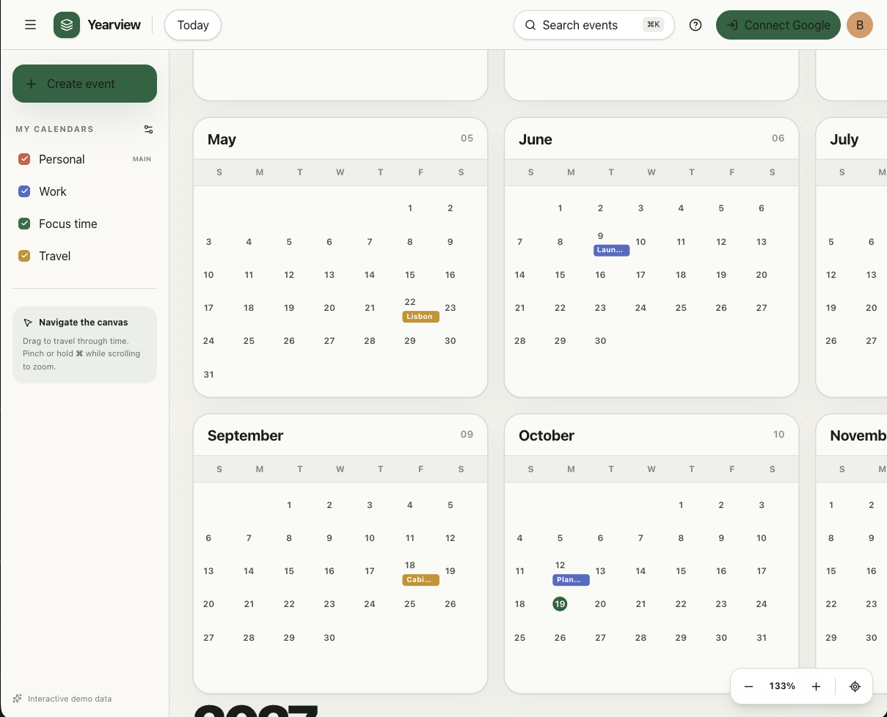

# Yearview

A fluid, pan-and-zoom Google Calendar for seeing the shape of an entire year.

Google Calendar's built-in year view shows dates. Yearview shows the actual
life inside those dates: events, calendars, locations, and reminders on one
continuous spatial canvas. Pan into earlier or later years, zoom from a broad
annual overview into individual days, and create or edit events without
leaving the view.



## Features

- Continuous pan-and-zoom timeline spanning multiple years
- Semantic zoom that keeps dense calendars legible
- Virtualized year rendering for smooth navigation
- Multiple calendar visibility controls
- Event search and keyboard navigation
- Create, update, and delete Google Calendar events
- All-day and timed events, locations, notes, and reminders
- Interactive demo mode when Google OAuth is not configured
- Responsive, accessible interface

## Getting started

Yearview requires Node.js 22.13 or newer.

```bash
npm install
npm run dev
```

The development server runs on `http://localhost:5173` by default.

## Google Calendar setup

1. Create a project in Google Cloud Console.
2. Enable the Google Calendar API.
3. Configure the OAuth consent screen.
4. Create an OAuth 2.0 Web client.
5. Add your local and deployed URLs as authorized JavaScript origins.
6. Copy `.env.example` to `.env.local` and set:

```bash
GOOGLE_CLIENT_ID=your-client-id.apps.googleusercontent.com
```

The browser requests the Google Calendar scope only when the user clicks
**Connect Google**. Access tokens stay in memory and are not persisted by the
application.

## Commands

```bash
npm run dev       # Start the development server
npm run build     # Create a production build
npm run start     # Preview the built Cloudflare Worker locally
npm run lint      # Run ESLint
```

## Stack

- React 19 and TypeScript
- Next.js-compatible routing via Vinext
- Vite and Cloudflare Workers
- Tailwind CSS
- Google Identity Services and Google Calendar API

## Contributing

Issues and pull requests are welcome. Keep changes focused, explain the user
impact, and include verification notes for interaction or layout changes.

## License

Yearview is free and open-source software licensed under the [MIT License](LICENSE).
